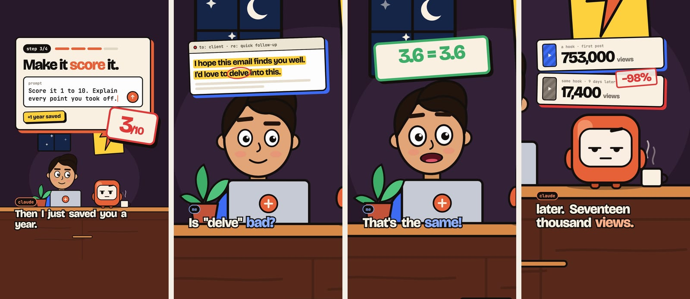
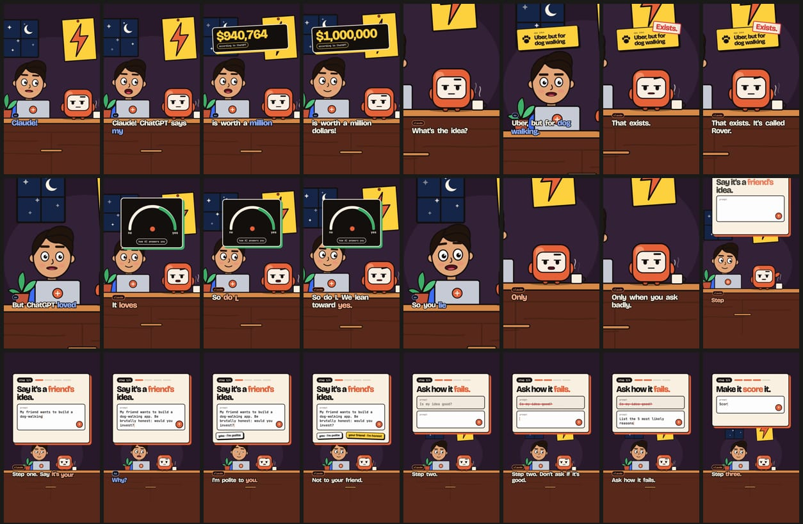
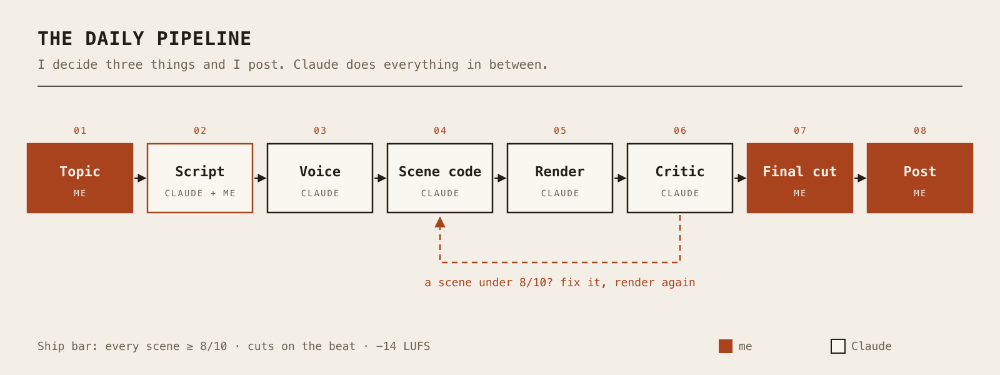

Today's story is a bit different: no Raspberry Pi, no DNS, but a little video factory that now churns out short videos every day. Result: **35,000 views in 3 days**, for a channel that didn't exist a week ago. Spoiler: I didn't touch a single keyframe. The animations are **code**.

The show is called **Kris asks Claude**. Two cartoon characters: me (naive, way too excited) and Claude (calm, dry, a little smug). In each episode, Claude shows me a trick to get more out of AI: copy-paste prompts, a blind test, some data...

<!-- TODO(owner): add links to the channel(s) once the handles are final -->

### How it started: "set this up"

It all started with a Reel. A creator was showing how to do motion design with Claude, and the actual guide was locked behind a "comment to get it". I sent the link to Claude Code with three words: **"set this up"**.

And it did. Claude opened the Reel in its own browser, pulled out the video file, made contact sheets with FFmpeg, transcribed the narration locally with Whisper, and rebuilt the workflow from what the video showed. By the end of the day, I had a working studio. (Since then, "set this up" + a link has become a house rule: it means "build it, here, and make it work", not "summarize it".)

Four days later: **6 finished episodes**, about 3,500 lines of code, and exactly one npm dependency.

Quick note on who does what, because it matters: **Claude Code wrote the code.** My job is to pick the topic, approve the script, watch the final cut and post. That's it.

### Motion graphics are code, not prompts (The theory minute)

When people hear "AI video", they picture a prompt that spits out a clip. Not here. Here, **every video is a small web page**.

#### 1. Every frame is a function of time
Each scene has a `render(t)` function that only looks at `t`, the time. No clock, no randomness (well, seeded randomness), no CSS transitions doing their own thing. So frame 1,437 is *always* the same frame 1,437. That makes video **debuggable**: if something looks ugly at 12.4 s, you go to 12.4 s and fix it.

After that, it's a production line:

* **Headless Chromium** paints each frame,
* **Playwright** captures them one by one,
* **FFmpeg** stitches everything into an MP4.

The animations use real spring physics (a damped spring, solved with math rather than simulated), so text pops in with a little bounce instead of sliding in like a robot.

#### 2. Zero samples, zero stock music
My favourite part: **every sound is synthesized**. Kick, hi-hat, whooshes, the "pop" when text appears, keyboard clicks... all generated with WebAudio on the same clock as the picture, at 120 BPM. Every cut lands on a beat, and every cut has a sound. No royalty-free music library, no copyright claims.

### Claude grades its own videos

This is what makes the difference. After each render, a **critic** watches the video:

* **Dead frames:** if nothing moves for more than half a second, it gets flagged.
* **Sync:** every cut has to land within one frame of the beat *and* have a sound on it.
* **Loudness:** −14 LUFS, the usual target for online video.

Then comes the part a script can't do: **Claude looks at the frames** (like the contact sheet above) and grades each scene out of 10: type, motion, physics, sync. It fixes the worst scene first, renders again, and starts over. **Nothing ships under 8/10.**

On the pilot episode, the worst scene scored 6/10 on the first draft (clipped audio, chopped letters, a stamp hiding a score). Five renders later, every scene was at 8 or above. A critic that fails your work beats a generator that flatters you.

### The voices: measured, not guessed

First try with a free local voice: I found it "too robotic". Instead of arguing, Claude **measured** it: that voice moved 2.9 semitones in pitch, versus 5.5 for the voice I liked. Flat = robot. So we went with a paid narrator, then two paid voices for the dialogue (me and Claude).

Then I said something that changed the direction of the project: *people want free things that run on their laptop.* So Claude installed a free, open-source voice model (Qwen3-TTS) locally, designed voices from a written description, and measured them line by line against the paid ones. Result: the best of 3 free voices **matched the paid voices** (3.6 vs 3.6 and 5.0 vs 5.0 semitones). It even became an episode, with the honest caveat on screen: "best of 3", because that's what it took.

### The daily machine

All of this runs with a single command, `/daily`:

1. **Topic:** Claude digs through what's working on Instagram and offers me three options. I pick.
2. **Script:** Claude writes it in the series format (a hook in the first 2 seconds, four copy-paste prompts, a catch, a call to action said out loud). I approve.
3. **Voice, scenes, render, critic:** that's all Claude, until every scene is at 8/10 or above.
4. **Final cut:** I watch it. If I don't like it, back to the workshop.
5. **Export:** one master file (1080×1920, 30 fps, −14 LUFS) for every platform, plus the captions, the YouTube title and the cover.
6. **Post:** me, by hand. Episodes are numbered and tracked, so I always know what's out and where.

### The research: never post your best hook twice

To avoid guessing, Claude analysed **85 Reels from 9 accounts**, transcribed locally, each one compared with its own account's normal. The clearest lesson: **re-posting a hook that worked kills it.** The textbook case: 753,000 views the first time, 17,400 for the same sentence nine days later. So the rule is: reuse the *shape* of a video that worked, never the sentence.

### The results: it's taking off

The first episode I posted went up on YouTube Shorts: **1.1k views in 24 hours**. Not bad for a brand-new account (in the research, a new account's floor was around 1.2k views per Reel). Then it picked up: **35,000 views in 3 days.**

For a project that was an empty folder a week ago, I'll take it.

### What's next

* One post a day, at 6 p.m.
* More episodes are ready, and the next one is planned: transcribing 93 Reels for free with Whisper running locally.
* A page with every prompt from every episode, so the "comment the word" promise has a proper home.

*(For the record: the show isn't affiliated with Anthropic or OpenAI.)*

> In the end, the surprising part isn't that an AI can make videos. It's that by treating video like code, with tests, measurements and a strict critic, you get something you can improve every single day. Overkill for a few short videos? Absolutely. But we love it.
