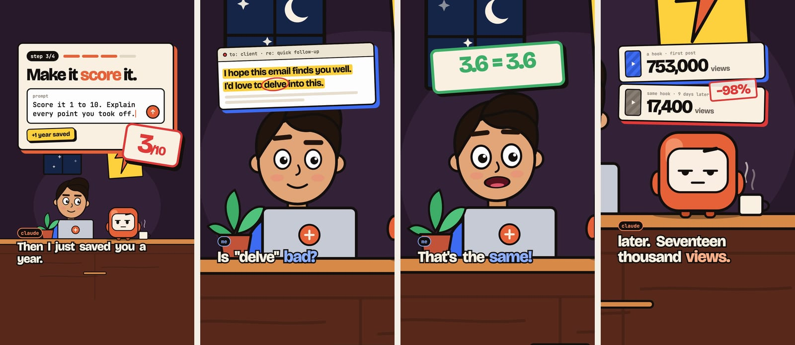
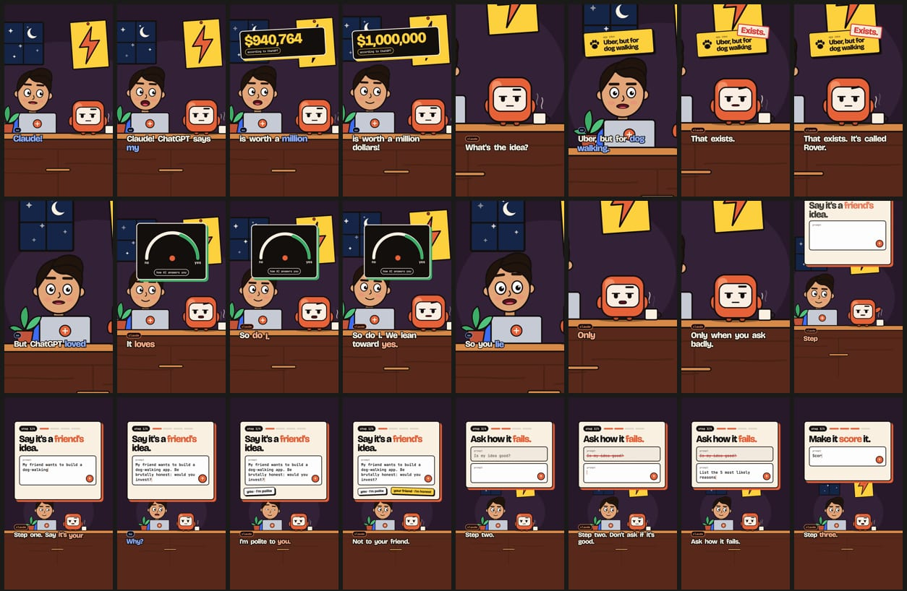
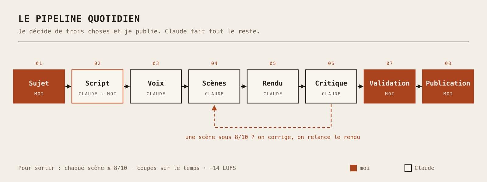

Aujourd'hui, histoire un peu différente : pas de Raspberry Pi, pas de DNS, mais une petite usine à vidéos qui sort maintenant des vidéos courtes tous les jours. Résultat : **35 000 vues en 3 jours**, pour une chaîne qui n'existait pas il y a une semaine. Spoiler : je n'ai pas touché une seule image clé. Les animations, c'est **du code**.

L'émission s'appelle **Kris asks Claude**. Deux personnages en dessin animé : moi (naïf, beaucoup trop enthousiaste) et Claude (calme, pince-sans-rire, un peu trop sûr de lui). Dans chaque épisode, Claude me montre une astuce pour tirer plus de l'IA : des prompts à copier-coller, un test à l'aveugle, des données...

<!-- TODO(owner): add links to the channel(s) once the handles are final -->

### Comment tout a commencé : « set this up »

Tout est parti d'un Reel. Un créateur montrait comment faire du motion design avec Claude, et le vrai guide était bloqué derrière un « commente pour le recevoir ». J'ai envoyé le lien à Claude Code avec trois mots : **« set this up »** (en gros, « mets ça en place »).

Et il l'a fait. Claude a ouvert le Reel dans son propre navigateur, récupéré le fichier vidéo, fait des planches contact avec FFmpeg, transcrit la narration en local avec Whisper, et reconstruit le workflow à partir de ce que montrait la vidéo. Le soir même, j'avais un studio qui tournait. (Depuis, « set this up » + un lien est devenu une règle de la maison : ça veut dire « construis-le, ici, et que ça marche », pas « fais-moi un résumé ».)

Quatre jours plus tard : **6 épisodes terminés**, environ 3 500 lignes de code, et exactement une dépendance npm.

Petite précision sur qui fait quoi, parce que c'est important : **c'est Claude Code qui a écrit le code.** Mon rôle, c'est de choisir le sujet, de valider le script, de regarder le montage final et de publier. C'est tout.

### Le motion design, c'est du code, pas des prompts (La minute théorie)

Quand on dit « vidéo IA », on imagine un prompt qui recrache un clip. Pas ici. Ici, **chaque vidéo est une petite page web**.

#### 1. Chaque image est une fonction du temps
Chaque scène a une fonction `render(t)` qui ne regarde que `t`, le temps. Pas d'horloge, pas de hasard (enfin, un hasard à graine fixe), pas de transitions CSS qui vivent leur vie. Du coup, l'image 1 437 est *toujours* la même image 1 437. Ça rend la vidéo **débogable** : si un truc est moche à 12,4 s, on va à 12,4 s et on corrige.

Ensuite, c'est une chaîne de production :

* **Chromium en mode headless** peint chaque image,
* **Playwright** les capture une par une,
* **FFmpeg** assemble le tout en MP4.

Les animations utilisent une vraie physique de ressort (un ressort amorti, résolu par le calcul plutôt que simulé) : le texte arrive avec un petit rebond au lieu de glisser comme un robot.

#### 2. Zéro sample, zéro musique libre de droits
Mon passage préféré : **chaque son est synthétisé**. Grosse caisse, charleston, les « whoosh », le « pop » quand un texte apparaît, les clics de clavier... tout est généré avec WebAudio sur la même horloge que l'image, à 120 BPM. Chaque coupe tombe sur un temps, et chaque coupe a son petit son. Pas de banque de musique, pas de réclamation pour droits d'auteur.

### Claude note ses propres vidéos

C'est ça qui fait la différence. Après chaque rendu, un **critique** regarde la vidéo :

* **Images mortes :** si rien ne bouge pendant plus d'une demi-seconde, c'est signalé.
* **Synchro :** chaque coupe doit tomber sur le temps à une image près, *et* avoir un son.
* **Volume :** −14 LUFS, la cible habituelle de la vidéo en ligne.

Vient ensuite la partie qu'un script ne sait pas faire : **Claude regarde les images** (comme la planche contact ci-dessus) et note chaque scène sur 10 : typo, mouvement, physique, synchro. Il corrige d'abord la pire scène, relance le rendu, et recommence. **Rien ne sort en dessous de 8/10.**

Sur l'épisode pilote, la pire scène a pris 6/10 au premier jet (son saturé, lettres coupées, un tampon qui cachait une note). Cinq rendus plus tard, toutes les scènes étaient à 8 ou plus. Un critique qui recale ton travail vaut mieux qu'un générateur qui te flatte.

### Les voix : mesurées, pas devinées

Premier essai avec une voix locale gratuite : je l'ai trouvée « trop robotique ». Au lieu de débattre, Claude l'a **mesurée** : cette voix variait de 2,9 demi-tons, contre 5,5 pour celle qui me plaisait. Plat = robot. On est donc partis sur un narrateur payant, puis deux voix payantes pour les dialogues (moi et Claude).

Et là, j'ai dit un truc qui a changé la direction du projet : *les gens veulent des trucs gratuits qui tournent sur leur ordi.* Claude a donc installé en local un modèle de voix gratuit et open source (Qwen3-TTS), créé des voix à partir d'une simple description écrite, et les a mesurées ligne par ligne contre les voix payantes. Résultat : la meilleure des 3 voix gratuites **égale les voix payantes** (3,6 contre 3,6 et 5,0 contre 5,0 demi-tons). C'est même devenu un épisode, avec la précision honnête à l'écran : « la meilleure de 3 », parce que c'est ce qu'il a fallu.

### La machine quotidienne

Tout ça tourne avec une seule commande, `/daily` :

1. **Le sujet :** Claude fouille ce qui marche sur Instagram et me propose trois options. Je choisis.
2. **Le script :** Claude l'écrit au format de la série (une accroche dans les 2 premières secondes, quatre prompts à copier-coller, un piège, un appel à l'action dit à voix haute). Je valide.
3. **Voix, scènes, rendu, critique :** tout ça, c'est Claude, jusqu'à ce que chaque scène soit à 8/10 ou plus.
4. **Le montage final :** je le regarde. Si ça ne me plaît pas, retour à l'atelier.
5. **L'export :** un seul fichier maître (1080×1920, 30 i/s, −14 LUFS) pour toutes les plateformes, plus les légendes, le titre YouTube et la miniature.
6. **La publication :** moi, à la main. Les épisodes sont numérotés et suivis, donc je sais toujours ce qui est sorti, et où.

### La recherche : ne jamais reposter sa meilleure accroche

Pour éviter de deviner, Claude a analysé **85 Reels de 9 comptes**, transcrits en local, chacun comparé à la normale de son propre compte. La leçon la plus nette : **reposter une accroche qui a marché, c'est la tuer.** Le cas d'école : 753 000 vues la première fois, 17 400 pour la même phrase neuf jours plus tard. D'où la règle : on réutilise la *forme* d'une vidéo qui a marché, jamais la phrase.

### Les résultats : ça décolle

Le premier épisode que j'ai publié est sorti sur YouTube Shorts : **1,1k vues en 24 heures**. Pas mal pour un compte tout neuf (dans la recherche, le plancher d'un nouveau compte tournait autour de 1,2k vues par Reel). Et puis ça s'est emballé : **35 000 vues en 3 jours.**

Pour un projet qui était un dossier vide il y a une semaine, je prends.

### La suite

* Une publication par jour, à 18 h.
* D'autres épisodes sont prêts, et le suivant est prévu : transcrire 93 Reels gratuitement avec Whisper en local.
* Une page avec tous les prompts de tous les épisodes, pour que la promesse « commente le mot » ait enfin une vraie maison.

*(Pour info : l'émission n'est affiliée ni à Anthropic ni à OpenAI.)*

> Au fond, le plus surprenant, ce n'est pas qu'une IA sache faire des vidéos. C'est qu'en traitant la vidéo comme du code, avec des tests, des mesures et un critique intransigeant, on obtient un truc qu'on peut améliorer tous les jours. Overkill pour quelques vidéos courtes ? Totalement. Mais on adore.
