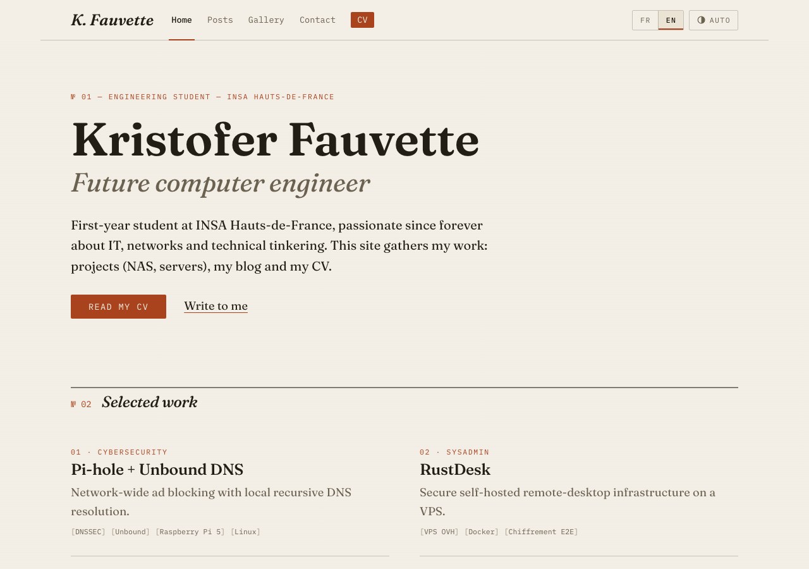
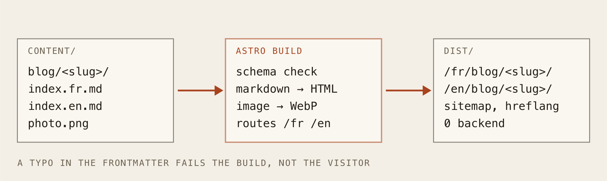
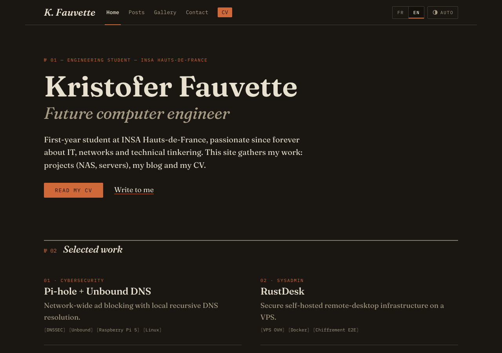
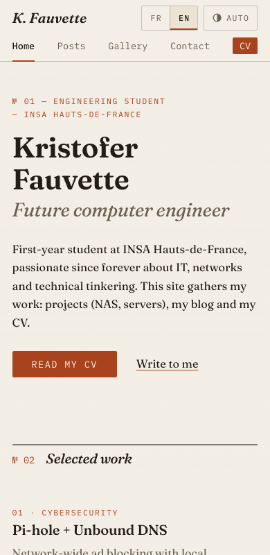
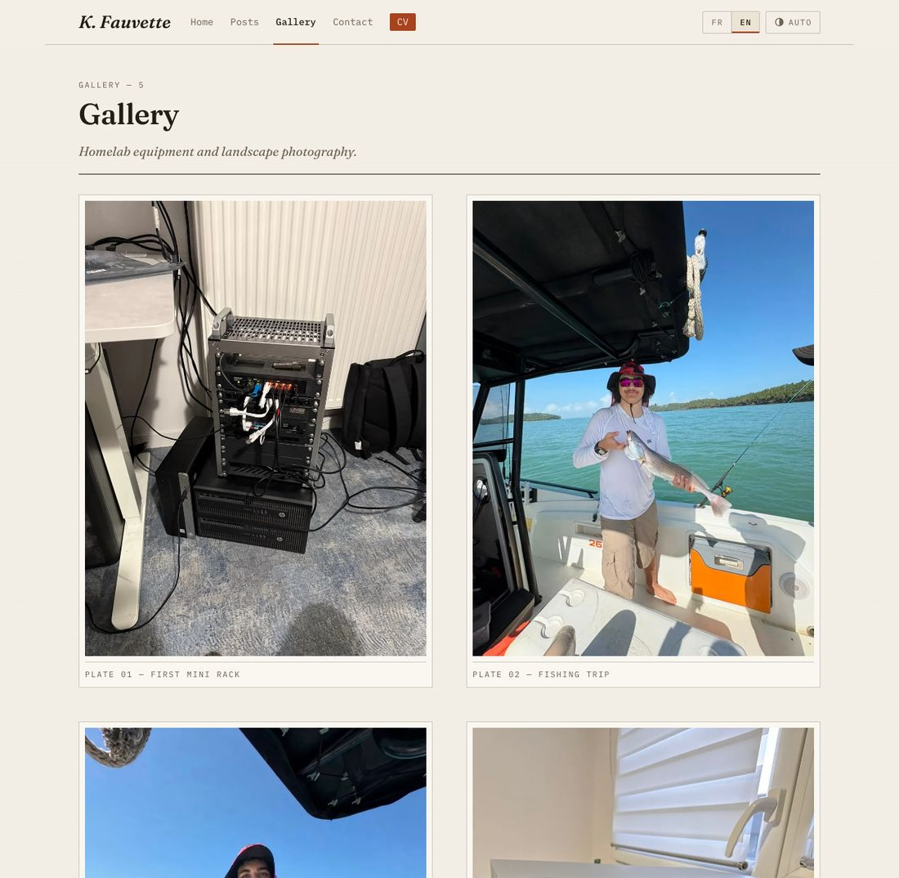

You are looking at the result. This post is about what came before, why it had to go, and how the new version works. Fair warning: there are bugs in this story, and they're the fun part.

A word on method: I did the rebuild in pair programming with Claude Code, an AI coding assistant, and the git history carries its co-author lines.

### Where the old site stood

The previous version was a React + Vite single-page app. It looked impressive, but when I audited it, the list of problems was long:

* **No real pages.** Articles and the CV opened as modals driven by a `useState`. No URL, no deep link, a broken back button, nothing for a search engine to index.
* **A 3D rack.** A decorative server rack rendered with three.js, backed by `.glb` models weighing well over 120 MB in total (one of them alone is around 84 MB). For decoration.
* **A chatbot needing its own server.** A Gemini-powered assistant that required a separate Express server and an API key. A "static" site that needed a second deployment.
* **Fake telemetry.** The "live homelab stats" (CPU, uptime, DNS queries) were pseudo-random numbers generated from the clock. That one bothered me the most: on a site meant to show my work, invented numbers are a liability.
* **Five Python scripts** in the repo root, used once to assemble those 3D models, and never cleaned up.

### The theory minute: static site vs SPA

#### 1. What is a SPA?
A single-page application ships one blob of JavaScript. Your browser downloads it, runs it, and the JavaScript draws everything, including "navigating" between pages. The URL doesn't really change, because there are no real pages.

#### 2. What is a static site?
A static site is the opposite: at build time, every page is generated once as plain HTML. The server just hands out files. No backend, no database, nothing to patch at 3 a.m.

* **Real URLs:** each article is a page you can link, bookmark and index.
* **Speed:** HTML arrives ready to read, with no JavaScript needed to display text.
* **Hosting:** any static host works. You copy the `dist/` folder and you're done.

#### 3. Why Astro?
Astro generates static HTML and ships zero JavaScript by default. Even better for me, its **content collections** are exactly the blog pipeline I wanted: Markdown files in a folder, validated by a schema, turned into routed pages. The stack is now Astro 5 and TypeScript, hand-written CSS on design tokens, and no UI framework or Tailwind.

### Publishing with zero code

The rule for the blog is simple: **a post is a folder**. The folder name becomes the URL.

```text
content/blog/my-new-post/
├── index.fr.md
├── index.en.md
└── screenshot.png
```

Each Markdown file starts with a small frontmatter block:

```markdown
---
title: "Post title"
date: 2026-07-10
excerpt: "One or two sentences shown on the listing page."
tags: ["Network", "DNS"]
---
```

That block is checked against a schema at build time. A typo in the date doesn't render a broken page; it **fails the build** with a readable error. Images sit in the same folder and are referenced relatively (``), and Astro optimizes and fingerprints them. The listing page, the "latest posts" on the home page, the sorting and the sitemap all derive from the collection. Nothing is hardcoded.



### Bilingual by design

Every page exists twice, under `/fr/…` and `/en/…`, generated from a single template. Each page declares its twin with `hreflang`, so search engines know which version to show to whom. The root `/` redirects according to the browser language, with a meta-refresh fallback to `/fr/`.

All the interface text lives in one file, `src/i18n/ui.ts`, and components just read `UI[lang]`. If a post only exists in one language, the language toggle sends you to the other language's blog index instead of a 404.

### The "engineer's journal" design

I wanted the opposite of the usual dark-blue-with-gradients portfolio. So the look is borrowed from print-era technical publishing: a field notebook.

* **Paper and ink:** a warm cream ground, near-black ink, and a single accent color, oxide rust. If I'm tempted to add a second accent or a glow, that's the sign to stop.
* **Type is the interface:** Fraunces (a serif with real italics) for text, IBM Plex Mono in small letterspaced capitals for the annotations: section numbers, dates, nav, `[tags]`.
* **Structure over decoration:** hairline rules, numbered sections (`№ 01`, `№ 02`…), almost no motion, and `prefers-reduced-motion` respected.
* **Lamplight:** dark mode isn't a different site, it's the same paper after sunset: warm blacks and cream ink. A three-state toggle (auto, dark, light) lives in the masthead.



The CV button is rust and sits in the masthead of every page. It's deliberately the loudest thing on the site: a recruiter should reach my CV in one click, from anywhere.



### The gallery pipeline

The same philosophy applies to photos: drop an image in `content/gallery/` and it shows up on the gallery page. The caption is derived from the file name (`2026-11_Three-Cisco-Catalyst-switches.jpg` becomes "Three Cisco Catalyst switches") and each photo is numbered as a "plate".



There is a lesson hiding here. **Phone photos carry GPS coordinates** in their metadata. The built WebP variants are stripped, but the originals sit in the repository, and the repository is public. So the rule is: downscale the photo (2400 px on the long edge at most) and strip its metadata *before* committing it.

### Bugs found along the way

* **The id that became "indexen".** Astro's glob loader slugifies file names to build entry ids, so `index.en.md` turned into `indexen`. The dot vanished, language detection failed, every post looked English, the French pages weren't generated and the English ones were emitted twice. The fix is a custom `generateId` that keeps the literal path. I caught it by reading the route list in the build log.
* **Dates one day early.** `date: 2025-12-08` is parsed as midnight UTC, but my date formatter used the machine's time zone, so the Pi-hole post said "7 décembre". The fix is one option, `timeZone: 'UTC'`. The build never complained about it: I only noticed it while looking at screenshots.
* **The 404 and hreflang.** A 404 page isn't the translation of any other page, so it shouldn't claim to have twins. Review caught that the 404 was emitting hreflang tags, and they're gone.

### What's next

Nothing is promised. The site is small on purpose, and the pipeline now makes the interesting part (writing) cheap. More posts, more photos, and I'll fix whatever breaks next.

> A website is a bit like a homelab: the best version is the one you can leave alone, and that still works when you come back. This one is just HTML, a few fonts and a rust-colored button.
