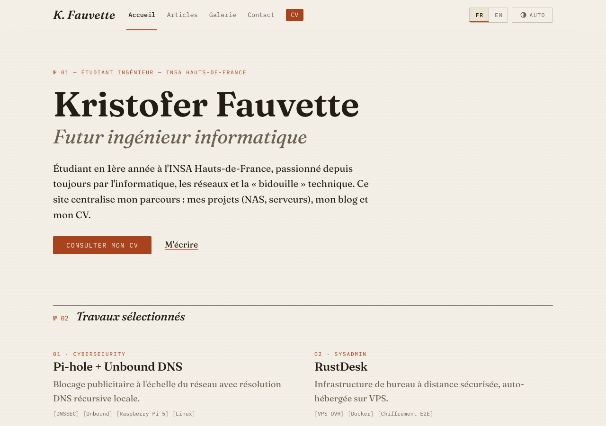
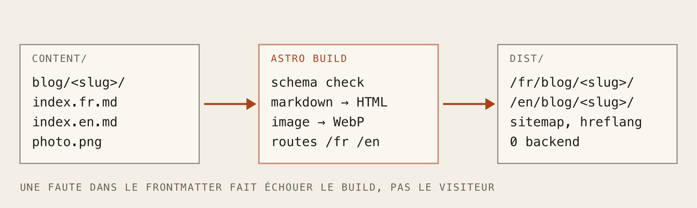
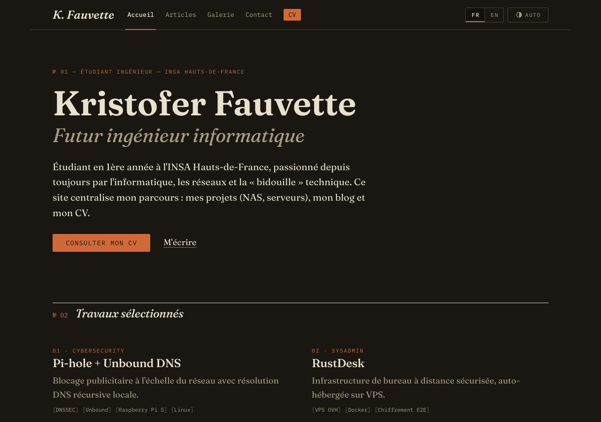
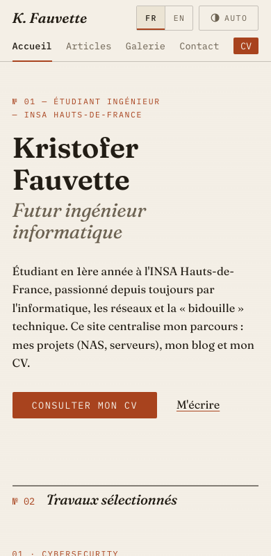
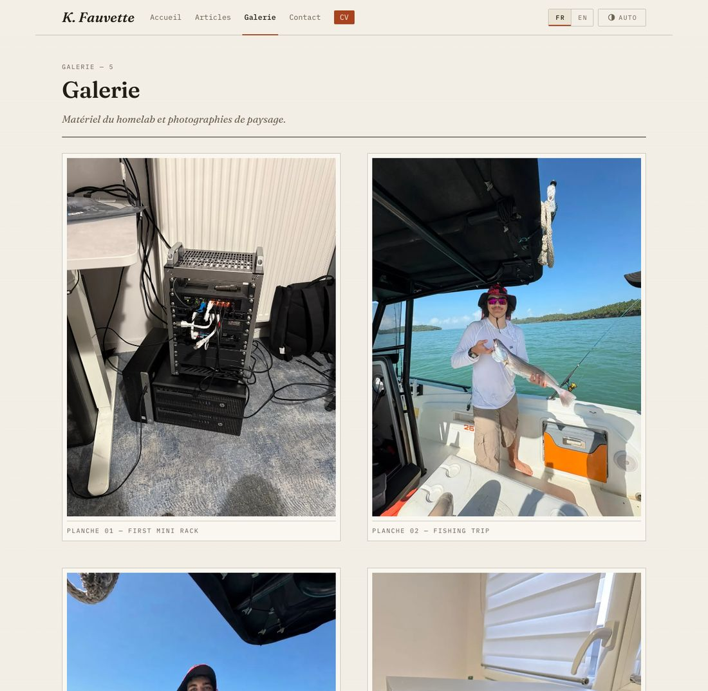

Vous avez le résultat sous les yeux. Cet article raconte ce qu'il y avait avant, pourquoi ça devait disparaître, et comment fonctionne la nouvelle version. Petite précision : il y a des bugs dans cette histoire, et c'est la partie rigolote.

Un mot sur la méthode : j'ai fait la refonte en binôme avec Claude Code, un assistant de programmation IA, et l'historique git porte ses mentions de co-auteur.

### D'où on partait

La version précédente était une SPA React + Vite. Elle en jetait, mais quand je l'ai auditée, la liste de problèmes était longue :

* **Pas de vraies pages.** Les articles et le CV s'ouvraient dans des modales pilotées par un `useState`. Pas d'URL, pas de lien direct, un bouton retour cassé, rien à indexer pour un moteur de recherche.
* **Un rack 3D.** Un rack de serveurs décoratif rendu avec three.js, adossé à des modèles `.glb` de bien plus de 120 Mo au total (un seul pèse environ 84 Mo). Pour de la déco.
* **Un chatbot avec son propre serveur.** Un assistant Gemini qui demandait un serveur Express séparé et une clé d'API. Un site « statique » avec un deuxième déploiement.
* **De la fausse télémétrie.** Les « stats live du homelab » (CPU, uptime, requêtes DNS) étaient des nombres pseudo-aléatoires générés à partir de l'horloge. C'est ce qui me gênait le plus : sur un site censé montrer mon travail, des chiffres inventés, c'est un risque.
* **Cinq scripts Python** à la racine du dépôt, utilisés une fois pour assembler ces modèles 3D, puis jamais nettoyés.

### La minute théorie : site statique vs SPA

#### 1. C'est quoi une SPA ?
Une application monopage (SPA) envoie un gros bloc de JavaScript. Votre navigateur le télécharge, l'exécute, et c'est le JavaScript qui dessine tout, y compris la « navigation » entre les pages. L'URL ne change presque pas, parce qu'il n'y a pas de vraies pages.

#### 2. C'est quoi un site statique ?
C'est l'inverse : à la compilation, chaque page est générée une fois pour toutes en HTML pur. Le serveur ne fait que distribuer des fichiers. Pas de backend, pas de base de données, rien à patcher à 3 h du matin.

* **De vraies URL :** chaque article est une page qu'on peut partager, mettre en favori et indexer.
* **Rapidité :** le HTML arrive prêt à lire, sans JavaScript pour afficher du texte.
* **Hébergement :** n'importe quel hébergeur statique convient. On copie le dossier `dist/` et c'est fini.

#### 3. Pourquoi Astro ?
Astro génère du HTML statique et n'envoie aucun JavaScript par défaut. Mieux : ses **collections de contenu** sont exactement le pipeline de blog que je voulais, des fichiers Markdown dans un dossier, validés par un schéma, transformés en pages routées. La stack est désormais Astro 5 et TypeScript, du CSS écrit à la main sur des design tokens, sans framework d'interface ni Tailwind.

### Publier sans écrire une ligne de code

La règle du blog est simple : **un article, c'est un dossier**. Le nom du dossier devient l'URL.

```text
content/blog/mon-nouvel-article/
├── index.fr.md
├── index.en.md
└── capture.png
```

Chaque fichier Markdown commence par un petit bloc de frontmatter :

```markdown
---
title: "Titre de l'article"
date: 2026-07-10
excerpt: "Une ou deux phrases affichées sur la page de liste."
tags: ["Network", "DNS"]
---
```

Ce bloc est vérifié contre un schéma au moment du build. Une faute de frappe dans la date ne produit pas une page cassée : elle **fait échouer le build** avec une erreur lisible. Les images vivent dans le même dossier et sont référencées en relatif (``), Astro les optimise et les fingerprinte. La page de liste, les « derniers articles » de l'accueil, le tri et le sitemap découlent tous de la collection. Rien n'est écrit en dur.



### Bilingue dès la conception

Chaque page existe en deux exemplaires, sous `/fr/…` et `/en/…`, générés à partir d'un seul modèle. Chaque page déclare sa jumelle avec `hreflang`, pour que les moteurs de recherche sachent quelle version montrer à qui. La racine `/` redirige selon la langue du navigateur, avec un repli en meta-refresh vers `/fr/`.

Tout le texte de l'interface vit dans un seul fichier, `src/i18n/ui.ts`, et les composants lisent simplement `UI[lang]`. Si un article n'existe que dans une langue, le bouton de langue envoie vers l'index du blog de l'autre langue plutôt que vers une 404.

### Le design « journal d'ingénieur »

Je voulais l'opposé du portfolio bleu nuit à dégradés habituel. Le style est donc emprunté à l'édition technique d'avant le numérique : un carnet de terrain.

* **Papier et encre :** un fond crème chaud, une encre quasi noire, et une seule couleur d'accent, le rouge rouille. Si je suis tenté d'ajouter un deuxième accent ou une lueur, c'est le signal pour m'arrêter.
* **La typo est l'interface :** Fraunces (une serif avec de vraies italiques) pour le texte, IBM Plex Mono en petites capitales espacées pour les annotations : numéros de section, dates, navigation, `[tags]`.
* **De la structure plutôt que de la décoration :** filets fins, sections numérotées (`№ 01`, `№ 02`…), presque aucune animation, et `prefers-reduced-motion` respecté.
* **Lamplight :** le mode sombre n'est pas un autre site, c'est le même papier après le coucher du soleil : noirs chauds et encre crème. Un sélecteur à trois états (auto, sombre, clair) trône dans l'en-tête.



Le bouton CV est rouille et présent dans l'en-tête de chaque page. C'est volontairement l'élément le plus voyant du site : un recruteur doit atteindre mon CV en un clic, de n'importe où.



### Le pipeline de la galerie

Même philosophie pour les photos : on dépose une image dans `content/gallery/` et elle apparaît sur la page galerie. La légende est dérivée du nom de fichier (`2026-11_Three-Cisco-Catalyst-switches.jpg` devient « Three Cisco Catalyst switches ») et chaque photo est numérotée comme une « planche ».



Il y a une leçon cachée ici. **Les photos de téléphone embarquent les coordonnées GPS** dans leurs métadonnées. Les variantes WebP générées au build sont nettoyées, mais les originaux, eux, sont dans le dépôt, et le dépôt est public. La règle : réduire la photo (2400 px maximum sur le grand côté) et supprimer ses métadonnées *avant* de la commiter.

### Les bugs croisés en route

* **L'identifiant devenu « indexen ».** Le loader `glob` d'Astro « slugifie » les noms de fichiers pour fabriquer les identifiants, donc `index.en.md` est devenu `indexen`. Le point a disparu, la détection de langue a échoué, tous les articles passaient pour de l'anglais, les pages françaises n'étaient pas générées et les anglaises étaient émises en double. La correction est un `generateId` personnalisé qui garde le chemin littéral. Je l'ai repéré en lisant la liste des routes dans le log du build.
* **Des dates avec un jour de retard.** `date: 2025-12-08` est lu comme minuit UTC, mais mon formateur de dates utilisait le fuseau horaire de la machine, et l'article Pi-hole affichait donc « 7 décembre ». La correction tient en une option, `timeZone: 'UTC'`. Le build ne s'est jamais plaint : je l'ai vu en regardant des captures d'écran.
* **La 404 et hreflang.** Une page 404 n'est la traduction d'aucune autre page, elle ne devrait donc pas prétendre avoir des jumelles. La relecture a relevé que la 404 émettait des balises hreflang, elles ont disparu.

### Et ensuite ?

Rien n'est promis. Le site est petit exprès, et le pipeline rend maintenant la partie intéressante (écrire) bon marché. Plus d'articles, plus de photos, et je réparerai ce qui cassera la prochaine fois.

> Un site web, c'est un peu comme un homelab : la meilleure version est celle qu'on peut laisser tranquille et qui fonctionne encore quand on revient. Celui-ci, c'est juste du HTML, quelques polices et un bouton couleur rouille.
