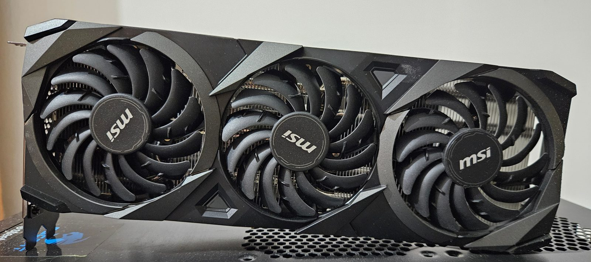
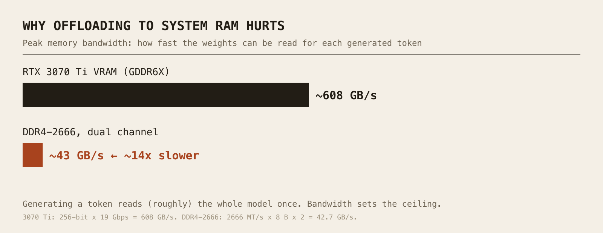
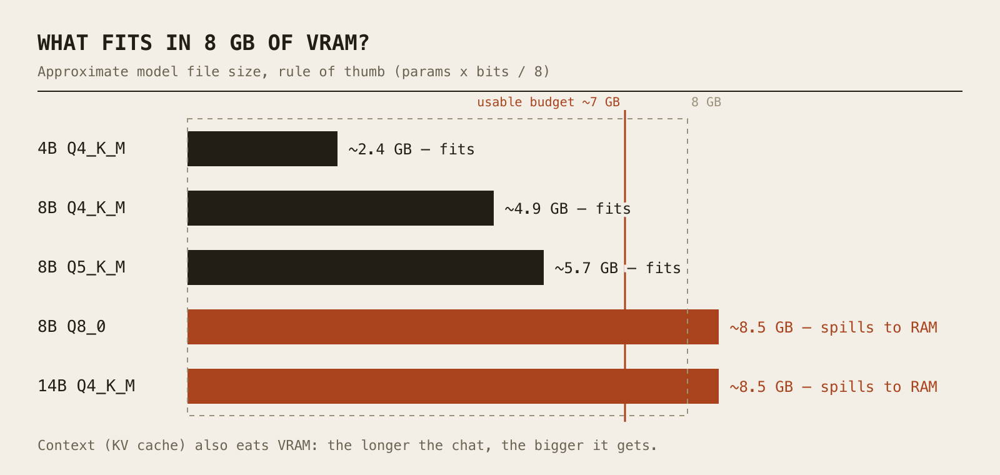

*An RTX 3070, the little sibling of the 3070 Ti I use. [Photo](https://commons.wikimedia.org/wiki/File:MSI_GeForce_RTX_3070_VENTUS_3X_OC.jpg): TheStriker, [CC BY 4.0](https://creativecommons.org/licenses/by/4.0/), via Wikimedia Commons (resized).*

Today we're running an AI **on my own PC**. No chatbot website, no account, no monthly fee: a language model that lives on my hard drive and thinks on my graphics card. Spoiler: it's not magic, it's mostly a memory-management game, and once you understand the rules, choosing a model becomes easy.

### Why bother running AI locally? (The theory minute)

* **Privacy:** your prompts never leave your machine. Handy for anything you wouldn't paste into a website.
* **Offline:** once the model is downloaded, no internet needed.
* **No subscription:** the electricity is the only meter running.
* **Learning:** nothing teaches you how these things work like breaking one yourself.

The trade-off, let's be honest: a model that fits on a home GPU is much smaller than the giants running in datacenters. It's very capable for its size, but don't expect it to match the biggest cloud models.

#### 1. VRAM is king

A language model is, physically, a huge pile of numbers (the **weights**). To produce each word (well, each *token*), the machine has to read basically **all of those weights**. So the real bottleneck is not raw compute, it's **how fast you can read memory**.

The graphics card has its own memory, the **VRAM**, which is extremely fast. That's why the number that matters most when choosing hardware for local AI is not the GPU's model name, it's **how many GB of VRAM it has**.

#### 2. What happens when the model doesn't fit?

LM Studio can split a model: some layers on the GPU, the rest in the system RAM, computed by the CPU. It works, but memory bandwidth is the catch.



Order of magnitude, from the spec sheets: the 3070 Ti's 256-bit bus at 19 Gbps gives about 608 GB/s. DDR4-2666 in dual channel gives 2666 MT/s × 8 bytes × 2 channels ≈ 43 GB/s. That's roughly **14 times less**. And since generating a token means reading (roughly) the whole model once, the ceiling on speed drops by about the same factor for the part of the model that sits in RAM. The CPU's 8 cores are not the problem here: they're waiting for memory.

Rule of thumb: **a model that fits entirely in VRAM feels fast, a model that spills over gets sluggish quickly.**

#### 3. Quantization, or how to shrink a model without lobotomizing it

Models are trained with 16-bit numbers. Stored like that, an 8-billion-parameter model weighs 8 × 10⁹ × 2 bytes ≈ **16 GB**. Too big for us.

**Quantization** stores each weight with fewer bits (4, 5, 8...). The model file you download is usually a **GGUF** file, the format LM Studio uses, and the name tells you the recipe:

| Quant | Approx. bits/weight | 8B model ≈ | In short |
|---|---|---|---|
| Q4_K_M | ~4.8 | ~4.9 GB | The classic sweet spot: small, quality loss is usually modest |
| Q5_K_M | ~5.7 | ~5.7 GB | A bit better, a bit bigger |
| Q8_0 | ~8.5 | ~8.5 GB | Close to the original, but heavy |

The formula is simply **parameters × bits ÷ 8**. Those bit counts are approximate averages (the "K" quants mix precisions), so treat the sizes as rule of thumb and trust the file size shown on the download page.

#### 4. Context length also costs memory

Besides the weights, the model keeps a **KV cache**: its short-term memory of the conversation. The longer the context window you ask for, the bigger the cache, and it lives in VRAM too. It can go from a few hundred MB to several GB depending on the model and the context length. So "the model fits" really means "the model **plus** the context fits".



### My setup

Nothing exotic, a regular gaming-type desktop:

* **GPU:** NVIDIA GeForce RTX 3070 Ti, **8 GB** GDDR6X
* **CPU:** Intel Core i7-10700F, 8 cores / 16 threads (no integrated graphics)
* **RAM:** 32 GB DDR4 at 2666 MHz
* **Software:** LM Studio

What does that mean in practice? The 8 GB of VRAM is the limiting factor: after the desktop takes its share, I count on roughly 7 GB for weights plus context. That's the sweet spot for models of **about 4 to 9 billion parameters in Q4/Q5**. The 32 GB of RAM lets me *load* much bigger models, but with DDR4-2666 the part running on the CPU will be slow. And since the CPU has no integrated graphics, the display runs on the same GPU, which is one more reason to keep a little VRAM free.

### What to download? (updated November 2026)

This moves fast, so take this as a snapshot rather than a verdict. At this update (November 2026), LM Studio's model catalog lists, among others, the **Qwen3.5** family (with 4B and 9B versions), **Gemma 4**, **Ministral 3** (8B) and **IBM Granite 4.1** (8B). Those sizes are the ones that sit comfortably in 8 GB at Q4. Bigger options like **gpt-oss 20B** don't: OpenAI sizes it for machines with 16 GB of memory, so on my card it would spill into RAM.

My advice: start with an 8-9B model in Q4_K_M, then compare with something smaller or bigger. Check the model's own page for its license and its strengths, and don't believe leaderboards blindly.

### Step 1: Install LM Studio

Download LM Studio from [lmstudio.ai](https://lmstudio.ai/) and install it like any other app. (It's free to use, but it's proprietary software. Open-source alternatives like Ollama or llama.cpp exist if that matters to you, but here we stick with LM Studio.)

### Step 2: Find and download a model

Open the **Discover** tab and search for a model by name (try "Qwen" or "Gemma"). Each model lists several quantizations. Pick a **Q4_K_M** whose file size is **comfortably under your VRAM** (for 8 GB, think 5 to 6 GB at most for the file itself, to leave room for the context).

<!-- TODO(owner): screenshot of the Discover tab with a Q4_K_M download -->

### Step 3: Load it and tune GPU offload

Go to the **Chat** tab, open the model loader and pick your model. Before loading, look at the load settings:

* **GPU Offload:** the number of layers sent to the GPU. If the whole model fits, push the slider to the maximum so that **everything runs on the GPU**. If it doesn't, lower it and accept the slowdown.
* **Context Length:** start moderate (a few thousand tokens), you can raise it later if VRAM allows.
* **Flash Attention:** if you see this option, it's worth trying: it typically reduces the memory used by long contexts.

<!-- TODO(owner): screenshot of the load settings (GPU Offload + Context Length) -->

Once you're happy, you can save these settings as the model's defaults from the **My Models** tab (gear icon).

### Step 4: First chat, and check your speed

Type a question. LM Studio shows a **tokens/s** figure for each answer. That's *your* number: I won't give you mine, because it depends on the model, the quantization and the context. Try the same prompt with a fully GPU-loaded model and then with a partially offloaded one. The difference tells you everything we said above.

### Bonus: a local OpenAI-compatible API

LM Studio can also run a local server. In the **Developer** tab, flip the **Start server** switch (or run `lms server start` in a terminal). By default it listens on port **1234**, and speaks the same language as the OpenAI API:

```bash
curl http://localhost:1234/v1/chat/completions \
  -H "Content-Type: application/json" \
  -d '{
    "model": "your-model-identifier",
    "messages": [{"role": "user", "content": "Explain VRAM in one sentence."}],
    "temperature": 0.7
  }'
```

Replace `your-model-identifier` with the identifier LM Studio displays for your loaded model. You can list what's available with `GET /v1/models`. Any tool that lets you change the OpenAI base URL to `http://localhost:1234/v1` can then use your local model.

### Limits and tips

* **Don't max out VRAM.** Leave headroom for the OS and the context, or things will crawl (or fail to load).
* **Q4_K_M first.** Only go up to Q5/Q8 if you have room and see a quality gain.
* **A smaller model fully on the GPU often beats a bigger one half in RAM** in everyday use.
* **Local models can still be wrong.** Smaller models hallucinate more; double-check anything important.
* **Disk space adds up quickly:** each model is several GB.

> And there you go! An AI that runs on my own machine, costs nothing per month, and teaches you something about memory every time it slows down. Overkill? Probably. But we love it.
