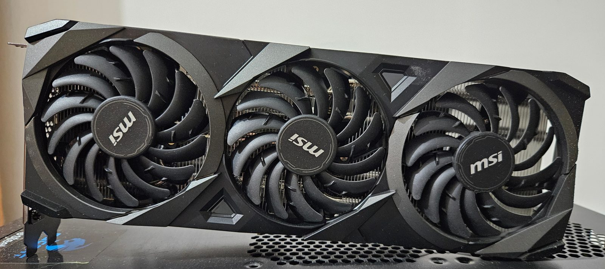
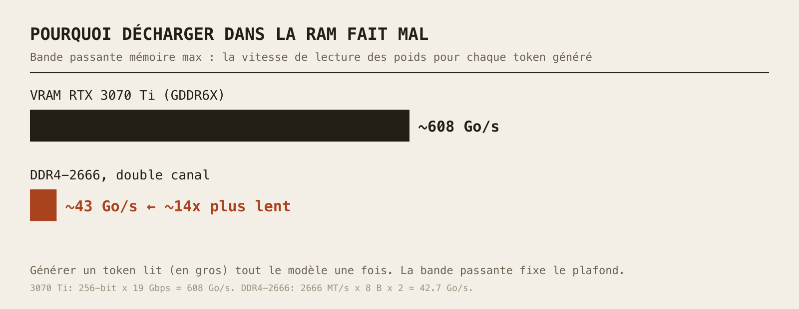
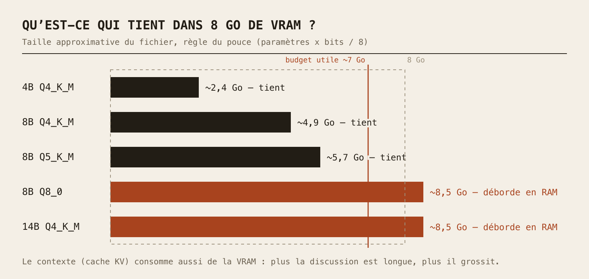

*Une RTX 3070, la petite sœur de la 3070 Ti que j'utilise. [Photo](https://commons.wikimedia.org/wiki/File:MSI_GeForce_RTX_3070_VENTUS_3X_OC.jpg) : TheStriker, [CC BY 4.0](https://creativecommons.org/licenses/by/4.0/), via Wikimedia Commons (redimensionnée).*

Aujourd'hui, on fait tourner une IA **sur mon propre PC**. Pas de site de chatbot, pas de compte, pas d'abonnement : un modèle de langage qui vit sur mon disque dur et réfléchit sur ma carte graphique. Spoiler : ce n'est pas de la magie, c'est surtout un jeu de gestion de mémoire, et une fois les règles comprises, choisir un modèle devient facile.

### Pourquoi faire tourner une IA en local ? (La minute théorie)

* **Confidentialité :** vos prompts ne quittent jamais votre machine. Pratique pour tout ce que vous ne colleriez pas sur un site web.
* **Hors ligne :** une fois le modèle téléchargé, plus besoin d'internet.
* **Zéro abonnement :** le seul compteur qui tourne, c'est l'électricité.
* **Apprendre :** rien ne vaut le fait de bidouiller soi-même pour comprendre comment ça marche.

Le revers de la médaille, soyons honnêtes : un modèle qui tient sur un GPU de salon est bien plus petit que les géants des datacenters. Il est très capable pour sa taille, mais ne vous attendez pas à égaler les plus gros modèles du cloud.

#### 1. La VRAM est reine

Un modèle de langage, physiquement, c'est un énorme tas de nombres (les **poids**). Pour produire chaque mot (enfin, chaque *token*), la machine doit lire à peu près **tous ces poids**. Le vrai goulot d'étranglement n'est donc pas la puissance de calcul brute, c'est **la vitesse à laquelle on lit la mémoire**.

La carte graphique possède sa propre mémoire, la **VRAM**, extrêmement rapide. C'est pourquoi, pour l'IA locale, le chiffre qui compte le plus n'est pas le nom du GPU, c'est **son nombre de Go de VRAM**.

#### 2. Et si le modèle ne tient pas ?

LM Studio sait couper un modèle en deux : certaines couches sur le GPU, le reste dans la RAM du PC, calculé par le CPU. Ça marche, mais la bande passante mémoire est le piège.



Ordre de grandeur, d'après les fiches techniques : le bus de 256 bits de la 3070 Ti à 19 Gbit/s donne environ 608 Go/s. La DDR4-2666 en double canal donne 2666 MT/s × 8 octets × 2 canaux ≈ 43 Go/s. Soit environ **14 fois moins**. Et comme générer un token revient à lire (en gros) tout le modèle une fois, le plafond de vitesse chute d'un facteur comparable pour la partie du modèle qui se trouve en RAM. Les 8 cœurs du CPU ne sont pas le problème : ils attendent la mémoire.

Règle du pouce : **un modèle qui tient entièrement en VRAM est rapide, un modèle qui déborde devient vite poussif.**

#### 3. La quantification, ou comment réduire un modèle sans le lobotomiser

Les modèles sont entraînés avec des nombres en 16 bits. Stocké ainsi, un modèle de 8 milliards de paramètres pèse 8 × 10⁹ × 2 octets ≈ **16 Go**. Trop gros pour nous.

La **quantification** stocke chaque poids avec moins de bits (4, 5, 8…). Le fichier que vous téléchargez est généralement un **GGUF**, le format utilisé par LM Studio, et son nom indique la recette :

| Quant | Bits/poids (approx.) | Modèle 8B ≈ | En bref |
|---|---|---|---|
| Q4_K_M | ~4,8 | ~4,9 Go | Le compromis classique : petit, perte de qualité généralement modeste |
| Q5_K_M | ~5,7 | ~5,7 Go | Un peu mieux, un peu plus gros |
| Q8_0 | ~8,5 | ~8,5 Go | Proche de l'original, mais lourd |

La formule est simplement **paramètres × bits ÷ 8**. Ces nombres de bits sont des moyennes approximatives (les quants « K » mélangent les précisions) : voyez les tailles comme une règle du pouce et fiez-vous à la taille du fichier affichée au téléchargement.

#### 4. La longueur de contexte coûte aussi de la mémoire

En plus des poids, le modèle garde un **cache KV** : sa mémoire à court terme de la conversation. Plus la fenêtre de contexte demandée est longue, plus ce cache grossit, et il vit lui aussi en VRAM. Il peut aller de quelques centaines de Mo à plusieurs Go selon le modèle et le contexte. « Le modèle tient » signifie donc en réalité « le modèle **plus** le contexte tiennent ».



### Mon setup

Rien d'exotique, un PC de bureau plutôt orienté jeu :

* **GPU :** NVIDIA GeForce RTX 3070 Ti, **8 Go** de GDDR6X
* **CPU :** Intel Core i7-10700F, 8 cœurs / 16 threads (pas de partie graphique intégrée)
* **RAM :** 32 Go de DDR4 à 2666 MHz
* **Logiciel :** LM Studio

Concrètement ? Les 8 Go de VRAM sont le facteur limitant : une fois la part du bureau retirée, je compte sur environ 7 Go pour les poids plus le contexte. C'est le terrain idéal pour des modèles d'**environ 4 à 9 milliards de paramètres en Q4/Q5**. Les 32 Go de RAM me permettent de *charger* des modèles bien plus gros, mais avec de la DDR4-2666, la partie calculée par le CPU sera lente. Et comme le CPU n'a pas de graphique intégré, l'affichage tourne sur ce même GPU : une raison de plus de garder un peu de VRAM libre.

### Quoi télécharger ? (mis à jour en novembre 2026)

Ça bouge vite, voyez donc ceci comme un instantané plutôt qu'un verdict. À cette mise à jour (novembre 2026), le catalogue de LM Studio propose notamment la famille **Qwen3.5** (avec des versions 4B et 9B), **Gemma 4**, **Ministral 3** (8B) et **IBM Granite 4.1** (8B). Ces tailles se logent confortablement dans 8 Go en Q4. Des options plus grosses comme **gpt-oss 20B**, non : OpenAI le dimensionne pour des machines dotées de 16 Go de mémoire, donc sur ma carte il déborderait en RAM.

Mon conseil : commencez par un modèle de 8-9B en Q4_K_M, puis comparez avec plus petit ou plus gros. Lisez la page du modèle pour sa licence et ses points forts, et ne croyez pas aveuglément les classements.

### Étape 1 : Installer LM Studio

Téléchargez LM Studio sur [lmstudio.ai](https://lmstudio.ai/) et installez-le comme n'importe quelle application. (Il est gratuit à l'usage, mais c'est un logiciel propriétaire. Des alternatives open source comme Ollama ou llama.cpp existent si c'est important pour vous, mais ici on reste sur LM Studio.)

### Étape 2 : Trouver et télécharger un modèle

Ouvrez l'onglet **Discover** et cherchez un modèle par son nom (essayez « Qwen » ou « Gemma »). Chaque modèle propose plusieurs quantifications. Choisissez un **Q4_K_M** dont la taille de fichier reste **confortablement sous votre VRAM** (pour 8 Go, pensez 5 à 6 Go maximum pour le fichier seul, afin de laisser de la place au contexte).

<!-- TODO(owner): capture d'écran de l'onglet Discover avec un téléchargement Q4_K_M -->

### Étape 3 : Charger le modèle et régler le GPU Offload

Allez dans l'onglet **Chat**, ouvrez le sélecteur de modèle et choisissez le vôtre. Avant de charger, regardez les paramètres de chargement :

* **GPU Offload :** le nombre de couches envoyées au GPU. Si tout le modèle tient, poussez le curseur au maximum pour que **tout tourne sur le GPU**. Sinon, baissez-le et acceptez le ralentissement.
* **Context Length :** commencez raisonnable (quelques milliers de tokens), vous pourrez l'augmenter ensuite si la VRAM le permet.
* **Flash Attention :** si l'option apparaît, elle mérite d'être essayée : elle réduit généralement la mémoire utilisée par les longs contextes.

<!-- TODO(owner): capture d'écran des paramètres de chargement (GPU Offload + Context Length) -->

Une fois satisfait, vous pouvez enregistrer ces réglages comme valeurs par défaut du modèle depuis l'onglet **My Models** (icône d'engrenage).

### Étape 4 : Première discussion, et mesurez votre vitesse

Posez une question. LM Studio affiche un chiffre en **tokens/s** pour chaque réponse. C'est *votre* chiffre : je ne vous donnerai pas le mien, car il dépend du modèle, de la quantification et du contexte. Essayez le même prompt avec un modèle entièrement chargé sur le GPU, puis avec un modèle partiellement déchargé. La différence résume tout ce qu'on vient de dire.

### Bonus : une API locale compatible OpenAI

LM Studio peut aussi lancer un serveur local. Dans l'onglet **Developer**, activez l'interrupteur **Start server** (ou lancez `lms server start` dans un terminal). Par défaut, il écoute sur le port **1234** et parle le même langage que l'API d'OpenAI :

```bash
curl http://localhost:1234/v1/chat/completions \
  -H "Content-Type: application/json" \
  -d '{
    "model": "your-model-identifier",
    "messages": [{"role": "user", "content": "Explique la VRAM en une phrase."}],
    "temperature": 0.7
  }'
```

Remplacez `your-model-identifier` par l'identifiant que LM Studio affiche pour votre modèle chargé. Vous pouvez lister les modèles disponibles avec `GET /v1/models`. Tout outil qui permet de changer l'URL de base d'OpenAI vers `http://localhost:1234/v1` peut alors utiliser votre modèle local.

### Limites et conseils

* **Ne saturez pas la VRAM.** Gardez de la marge pour le système et le contexte, sinon ça rame (ou ça ne charge pas).
* **Q4_K_M d'abord.** Ne montez en Q5/Q8 que si vous avez la place et constatez un gain de qualité.
* **Un petit modèle entièrement sur le GPU bat souvent un gros à moitié en RAM** à l'usage.
* **Un modèle local peut se tromper.** Les petits modèles hallucinent davantage : vérifiez ce qui compte.
* **L'espace disque part vite :** chaque modèle pèse plusieurs Go.

> Et voilà ! Une IA qui tourne sur ma propre machine, qui ne coûte rien par mois, et qui vous apprend un truc sur la mémoire à chaque fois qu'elle ralentit. Overkill ? Probablement. Mais on adore ça.
