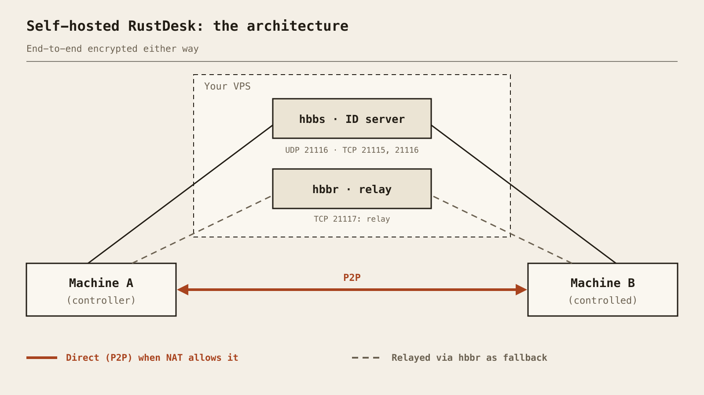

Say goodbye to TeamViewer and its limitations. **RustDesk** is a powerful open-source alternative for remote desktop control, self-hosted on your VPS. Performance, security, and total control: that's what we love.

### Why RustDesk?
RustDesk offers a complete remote desktop solution with end-to-end encryption, self-hosting capability, and a simple interface. Perfect for managing your servers, helping your loved ones, or working from anywhere.

#### Key Advantages
* **Open-Source:** Source code available, security audit possible
* **Self-Hosted:** Control your own ID and relay servers
* **Performance:** Written in Rust, fast and lightweight
* **Multi-Platform:** Windows, Linux, macOS, Android, iOS
* **Encryption:** Sessions are end-to-end encrypted

---

### How does it work? (The theory minute)

Before pasting commands, let's understand what we are about to deploy. The open-source RustDesk server is **two small programs**, not one:

* **hbbs**, the *ID / rendezvous server*. Each client registers with it and gets an ID (the number you read out to a friend). When A wants to reach B, hbbs introduces them and helps them punch through their routers (NAT hole punching). It also holds the server's key pair.
* **hbbr**, the *relay server*. If A and B can't talk directly (strict NAT, corporate firewall...), the traffic goes through hbbr instead. It's slower and uses your VPS bandwidth, but it works.



In the ideal case the connection is **direct (P2P)** between the two machines: the VPS only played matchmaker. Otherwise it is **relayed**. Either way, the session content is **end-to-end encrypted between the two clients**: the relay only forwards data it can't read.

And the **key pair**? On first start, hbbs generates `id_ed25519` (private, stays on the server) and `id_ed25519.pub` (public). Clients are given the public key, and that's how they know they're talking to *your* server and not an impostor. Keep that in mind, we'll need it.

### Prerequisites

* A VPS with a public IP (mine is an OVH VPS: 4 vCores, 8 GB RAM, 75 GB SSD, Ubuntu Server). Honestly, RustDesk's server is light: a far smaller VPS would do.
* Docker and the Docker Compose plugin (`docker compose version` should answer).
* Optional but nice: a DNS A record such as `rustdesk.example.com` pointing to `<VPS_IP>`. You can use the bare IP instead.

### Step 1: The Docker Compose file

The first version of this post used a single `docker run`. That was wrong: the official image contains both binaries, and you need to start **two** containers, one for `hbbs` and one for `hbbr`. This is the Compose file from the official documentation:

```bash
mkdir -p ~/rustdesk && cd ~/rustdesk
nano compose.yaml
```

```yaml
services:
  hbbs:
    container_name: hbbs
    image: rustdesk/rustdesk-server:latest
    command: hbbs
    volumes:
      - ./data:/root
    network_mode: "host"
    depends_on:
      - hbbr
    restart: unless-stopped

  hbbr:
    container_name: hbbr
    image: rustdesk/rustdesk-server:latest
    command: hbbr
    volumes:
      - ./data:/root
    network_mode: "host"
    restart: unless-stopped
```

Two things to note:

* `network_mode: "host"` (Linux only) lets the servers see the clients' real IP instead of the Docker bridge's, and it means no `ports:` section is needed. The official docs suggest trying without it if you run into connection problems.
* Both containers share `./data`, mounted on `/root`: that's where the key pair lives.

### Step 2: Open the firewall

With host networking, Docker doesn't publish ports for you, so open them in `ufw`. Only these are needed for a classic setup:

```bash
sudo ufw allow 21115/tcp   # hbbs: NAT type test
sudo ufw allow 21116/tcp   # hbbs: hole punching and connection
sudo ufw allow 21116/udp   # hbbs: ID registration and heartbeat
sudo ufw allow 21117/tcp   # hbbr: relay
sudo ufw status
```

Here is the full port map, as documented:

| Port | Protocol | Service | Role |
|---|---|---|---|
| 21114 | TCP | hbbs | Web console, **Pro only**: not needed |
| 21115 | TCP | hbbs | NAT type test |
| 21116 | **TCP and UDP** | hbbs | UDP: ID registration and heartbeat. TCP: hole punching and connection |
| 21117 | TCP | hbbr | Relay |
| 21118 | TCP | hbbs | Web client support (optional) |
| 21119 | TCP | hbbr | Web client support (optional) |

The classic mistake is forgetting that 21116 must be open in **both TCP and UDP**.

> If your OVH VPS has the optional **Network Firewall** enabled in the OVH control panel, it filters before `ufw` even sees the packets: add the same rules there too.

### Step 3: Start it and grab the public key

```bash
docker compose up -d
docker compose ps
docker logs hbbs
```

On first start, hbbs generates the key pair in the data folder. Read the public key:

```bash
cat ~/rustdesk/data/id_ed25519.pub
```

Copy that string (a short base64 line). It's the **Key** your clients need.

### Step 4: Configure the clients

Install the RustDesk client from the official site on each machine (desktop or mobile). On desktop, click the menu (⋮) next to your ID, then **Network**, unlock the settings (admin rights needed) and fill:

* **ID Server:** `rustdesk.example.com` (or `<VPS_IP>`). You can append the port, `:21116`.
* **Relay Server:** `rustdesk.example.com`, or leave it empty: the docs say RustDesk can infer it (it's hbbr, port 21117).
* **API Server:** leave empty. It's for the Pro edition only.
* **Key:** the content of `id_ed25519.pub`.

Click **Apply**. On Android and iOS it's the same menu, in the app's settings under the network/server section. Do it on **both** the controlling and the controlled device. Tip: configure one client, use *Export Server Config*, then *Import Server Config* on the others.

<!-- TODO(owner): screenshot of the ID/Relay server settings -->

After a few seconds the ID shown on the main screen should lose its "not ready" status: the client is registered with *your* server.

### Step 5: Test it

Connect from one machine to the other with its ID and password. In the session window, the lock/security icon tells you how it's going: it says whether the connection is **direct** or **relayed**, and that it's encrypted.

Want to see the difference? Test on the same network or from two different networks. Direct is the norm when NAT allows it; relayed is what you'll see behind strict firewalls. You can also watch the logs while connecting:

```bash
docker logs -f hbbr
```

If hbbr logs activity during your session, you're going through the relay.

### Keep it up to date

```bash
cd ~/rustdesk
docker compose pull
docker compose up -d
docker image prune -f
```

Your `./data` folder (and thus your key) survives upgrades.

### Security hardening

* **Open only what you need:** 21115, 21116 (TCP+UDP), 21117. Keep 21114 closed (Pro only).
* **Web client ports (21118/21119):** keep them closed unless you use the web client. If you do, expose them only through a reverse proxy that sets `X-Real-IP`, and firewall them so that only the proxy can connect: the docs warn that the servers trust those headers without validating them.
* **Enforce the key:** add `-k _` to both commands (`command: hbbs -k _` and `command: hbbr -k _`) so that clients without your key can't use your servers, then `docker compose up -d` again. Heads up: some users report this not behaving as expected, so always test with a client that has *no* key configured.
* **Back up the key pair:** copy `id_ed25519` and `id_ed25519.pub` somewhere safe. Lose them and every client must be reconfigured with the new public key. And never publish the private one.
* Use a strong permanent password on the machines you control, and keep clients up to date.

### Troubleshooting

* **"Key mismatch" / "Wrong key":** the Key field doesn't match the server's `id_ed25519.pub`. Recopy it without trailing spaces, and check you didn't regenerate the data folder.
* **ID never gets registered, or stuck on "Connecting...":** the usual suspect is **UDP 21116** blocked by `ufw` or by OVH's Network Firewall. Check TCP and UDP.
* **Direct works, relay doesn't (or the opposite):** check 21117/TCP, and that hbbr is running (`docker compose ps`).
* **Still stuck:** try removing `network_mode: "host"` and publishing the ports instead, as the docs suggest, and read `docker logs hbbs` and `docker logs hbbr`.

> And there you go! Your own RustDesk server, with an ID server, a relay and a key that only your clients know. No more third-party servers in the middle, and the remote desktop that works the way you want.
