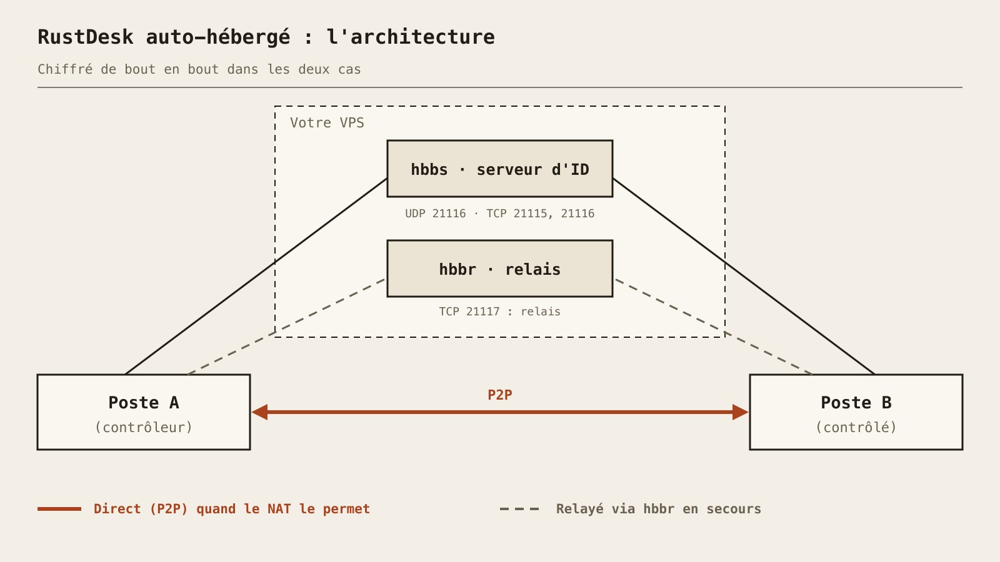

Dites adieu à TeamViewer et ses limitations. **RustDesk** est une alternative open-source puissante pour le contrôle à distance, auto-hébergée sur votre VPS. Performance, sécurité et contrôle total : c'est ce qu'on aime.

### Pourquoi RustDesk ?
RustDesk offre une solution complète de bureau à distance avec chiffrement de bout en bout, auto-hébergement possible, et une interface simple. Parfait pour gérer vos serveurs, aider vos proches, ou travailler depuis n'importe où.

#### Avantages clés
* **Open-Source :** Code source disponible, audit de sécurité possible
* **Auto-hébergement :** Contrôlez vos propres serveurs d'ID et de relais
* **Performance :** Écrit en Rust, rapide et léger
* **Multi-plateforme :** Windows, Linux, macOS, Android, iOS
* **Chiffrement :** Les sessions sont chiffrées de bout en bout

---

### Comment ça marche ? (La minute théorie)

Avant de copier-coller des commandes, comprenons ce qu'on va déployer. Le serveur RustDesk open-source, c'est **deux petits programmes**, pas un seul :

* **hbbs**, le *serveur d'ID / de rendez-vous*. Chaque client s'y enregistre et reçoit un ID (le numéro que vous dictez à un proche). Quand A veut joindre B, hbbs les présente et les aide à percer leurs box (NAT hole punching). C'est aussi lui qui porte la paire de clés du serveur.
* **hbbr**, le *serveur de relais*. Si A et B ne peuvent pas se parler directement (NAT strict, pare-feu d'entreprise...), le trafic passe par hbbr. C'est plus lent et ça consomme la bande passante de votre VPS, mais ça marche.



Dans le meilleur des cas, la connexion est **directe (P2P)** entre les deux machines : le VPS n'a fait que l'entremetteur. Sinon elle est **relayée**. Dans les deux cas, le contenu de la session est **chiffré de bout en bout entre les deux clients** : le relais transmet des données qu'il ne sait pas lire.

Et la **paire de clés** ? Au premier démarrage, hbbs génère `id_ed25519` (privée, elle reste sur le serveur) et `id_ed25519.pub` (publique). On donne la clé publique aux clients : c'est ainsi qu'ils savent parler à *votre* serveur et pas à un imposteur. Gardez-le en tête, on en aura besoin.

### Prérequis

* Un VPS avec une IP publique (le mien est un VPS OVH : 4 vCores, 8 Go de RAM, 75 Go de SSD, Ubuntu Server). Franchement, le serveur RustDesk est léger : un VPS bien plus petit suffirait.
* Docker et le plugin Docker Compose (`docker compose version` doit répondre).
* Optionnel mais agréable : un enregistrement DNS A du type `rustdesk.example.com` pointant vers `<VPS_IP>`. On peut aussi utiliser l'IP brute.

### Étape 1 : Le fichier Docker Compose

La première version de cet article utilisait un seul `docker run`. C'était faux : l'image officielle contient les deux binaires et il faut lancer **deux** conteneurs, un pour `hbbs` et un pour `hbbr`. Voici le fichier Compose de la documentation officielle :

```bash
mkdir -p ~/rustdesk && cd ~/rustdesk
nano compose.yaml
```

```yaml
services:
  hbbs:
    container_name: hbbs
    image: rustdesk/rustdesk-server:latest
    command: hbbs
    volumes:
      - ./data:/root
    network_mode: "host"
    depends_on:
      - hbbr
    restart: unless-stopped

  hbbr:
    container_name: hbbr
    image: rustdesk/rustdesk-server:latest
    command: hbbr
    volumes:
      - ./data:/root
    network_mode: "host"
    restart: unless-stopped
```

Deux points à noter :

* `network_mode: "host"` (Linux uniquement) permet aux serveurs de voir la vraie IP des clients plutôt que celle du pont Docker, et évite d'écrire une section `ports:`. La doc officielle conseille d'essayer sans en cas de problème de connexion.
* Les deux conteneurs partagent `./data`, monté sur `/root` : c'est là que vit la paire de clés.

### Étape 2 : Ouvrir le pare-feu

En mode réseau hôte, Docker ne publie aucun port à votre place : on les ouvre dans `ufw`. Pour une installation classique, seuls ceux-ci sont nécessaires :

```bash
sudo ufw allow 21115/tcp   # hbbs : test du type de NAT
sudo ufw allow 21116/tcp   # hbbs : hole punching et connexion
sudo ufw allow 21116/udp   # hbbs : enregistrement des ID et heartbeat
sudo ufw allow 21117/tcp   # hbbr : relais
sudo ufw status
```

Voici la carte complète des ports, telle que documentée :

| Port | Protocole | Service | Rôle |
|---|---|---|---|
| 21114 | TCP | hbbs | Console web, **Pro uniquement** : inutile ici |
| 21115 | TCP | hbbs | Test du type de NAT |
| 21116 | **TCP et UDP** | hbbs | UDP : enregistrement des ID et heartbeat. TCP : hole punching et connexion |
| 21117 | TCP | hbbr | Relais |
| 21118 | TCP | hbbs | Support du client web (optionnel) |
| 21119 | TCP | hbbr | Support du client web (optionnel) |

L'erreur classique : oublier que le 21116 doit être ouvert en **TCP et en UDP**.

> Si votre VPS OVH a le **Network Firewall** optionnel activé dans l'espace client OVH, il filtre avant même que `ufw` ne voie les paquets : ajoutez-y les mêmes règles.

### Étape 3 : Démarrer et récupérer la clé publique

```bash
docker compose up -d
docker compose ps
docker logs hbbs
```

Au premier démarrage, hbbs génère la paire de clés dans le dossier de données. Lisez la clé publique :

```bash
cat ~/rustdesk/data/id_ed25519.pub
```

Copiez cette chaîne (une courte ligne en base64). C'est la **Clé** (Key) dont vos clients ont besoin.

### Étape 4 : Configurer les clients

Installez le client RustDesk depuis le site officiel sur chaque machine (ordinateur ou mobile). Sur ordinateur, cliquez sur le menu (⋮) à côté de votre ID, puis **Réseau**, déverrouillez les paramètres (droits administrateur requis) et remplissez :

* **Serveur d'ID (ID Server) :** `rustdesk.example.com` (ou `<VPS_IP>`). On peut ajouter le port, `:21116`.
* **Serveur relais (Relay Server) :** `rustdesk.example.com`, ou laissez vide : la doc indique que RustDesk peut le déduire (c'est hbbr, port 21117).
* **Serveur API (API Server) :** laissez vide. Il ne concerne que l'édition Pro.
* **Clé (Key) :** le contenu de `id_ed25519.pub`.

Cliquez sur **Appliquer**. Sur Android et iOS, c'est le même menu, dans les paramètres de l'application, section réseau/serveur. Faites-le sur les **deux** appareils, celui qui contrôle et celui qui est contrôlé. Astuce : configurez un client, utilisez *Exporter la configuration du serveur*, puis *Importer la configuration du serveur* sur les autres.

<!-- TODO(owner): screenshot of the ID/Relay server settings -->

Après quelques secondes, l'ID affiché sur l'écran principal ne doit plus être « pas prêt » : le client est enregistré auprès de *votre* serveur.

### Étape 5 : Tester

Connectez-vous d'une machine à l'autre avec son ID et son mot de passe. Dans la fenêtre de session, l'icône de cadenas/sécurité vous renseigne : elle indique si la connexion est **directe** ou **relayée**, et qu'elle est chiffrée.

Envie de voir la différence ? Testez depuis le même réseau, puis depuis deux réseaux différents. Le direct est la norme quand le NAT le permet ; le relayé, c'est ce que vous verrez derrière des pare-feu stricts. Vous pouvez aussi surveiller les logs pendant la connexion :

```bash
docker logs -f hbbr
```

Si hbbr affiche de l'activité pendant votre session, vous passez par le relais.

### Mettre à jour

```bash
cd ~/rustdesk
docker compose pull
docker compose up -d
docker image prune -f
```

Votre dossier `./data` (donc votre clé) survit aux mises à jour.

### Durcir la sécurité

* **N'ouvrez que le nécessaire :** 21115, 21116 (TCP+UDP), 21117. Gardez le 21114 fermé (Pro uniquement).
* **Ports du client web (21118/21119) :** gardez-les fermés si vous n'utilisez pas le client web. Sinon, exposez-les uniquement derrière un reverse proxy qui renseigne `X-Real-IP`, et filtrez-les pour que seul ce proxy puisse s'y connecter : la doc prévient que les serveurs font confiance à ces en-têtes sans les valider.
* **Imposer la clé :** ajoutez `-k _` aux deux commandes (`command: hbbs -k _` et `command: hbbr -k _`) pour que les clients sans votre clé ne puissent pas utiliser vos serveurs, puis refaites `docker compose up -d`. Attention : certains utilisateurs rapportent que ça ne se comporte pas toujours comme prévu, testez donc toujours avec un client qui n'a *aucune* clé configurée.
* **Sauvegardez la paire de clés :** copiez `id_ed25519` et `id_ed25519.pub` en lieu sûr. Si vous les perdez, il faudra reconfigurer tous les clients avec la nouvelle clé publique. Et ne publiez jamais la privée.
* Utilisez un mot de passe permanent solide sur les machines contrôlées, et gardez les clients à jour.

### Dépannage

* **« Key mismatch » / « Wrong key » :** le champ Clé ne correspond pas au `id_ed25519.pub` du serveur. Recopiez-le sans espace en fin de ligne, et vérifiez que vous n'avez pas régénéré le dossier de données.
* **L'ID ne s'enregistre jamais, ou « Connexion... » sans fin :** le suspect habituel est le **UDP 21116** bloqué par `ufw` ou par le Network Firewall d'OVH. Vérifiez TCP et UDP.
* **Le direct marche, pas le relais (ou l'inverse) :** vérifiez le 21117/TCP, et que hbbr tourne (`docker compose ps`).
* **Toujours bloqué :** essayez de retirer `network_mode: "host"` et de publier les ports à la place, comme le suggère la doc, et lisez `docker logs hbbs` et `docker logs hbbr`.

> Et voilà ! Votre propre serveur RustDesk, avec un serveur d'ID, un relais et une clé que seuls vos clients connaissent. Plus de serveur tiers au milieu, et un bureau à distance qui fonctionne comme vous le voulez.
